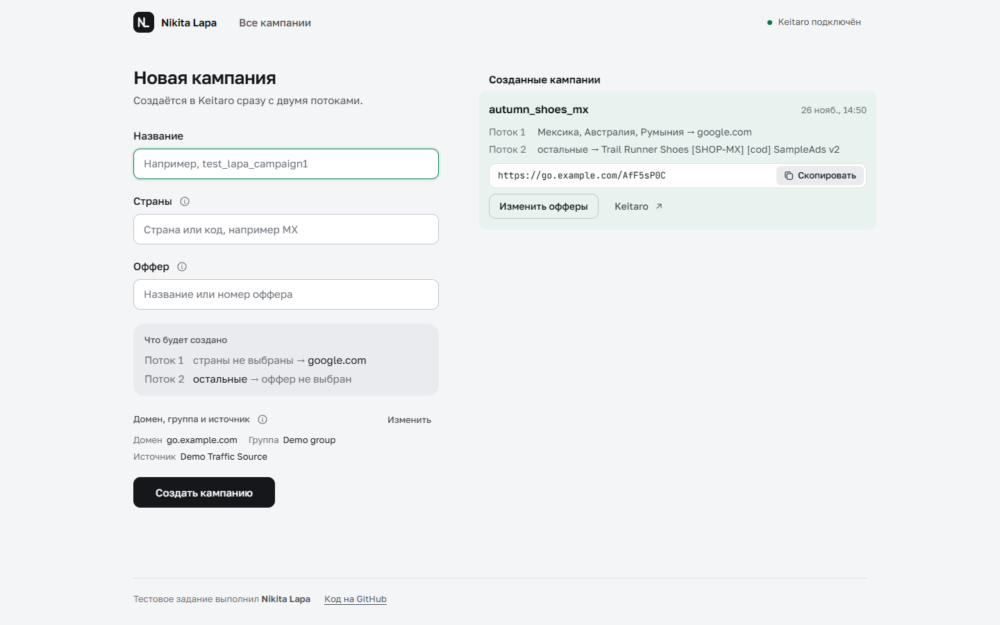
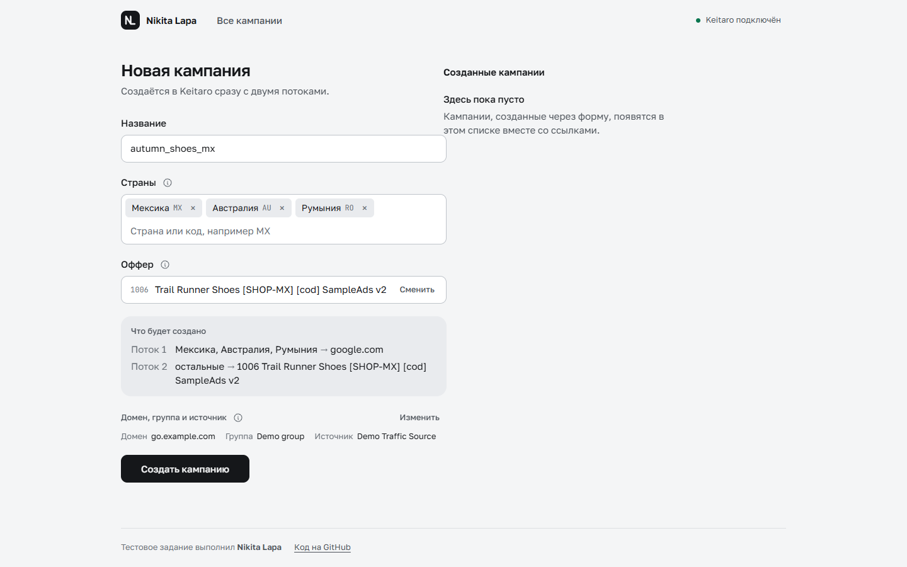
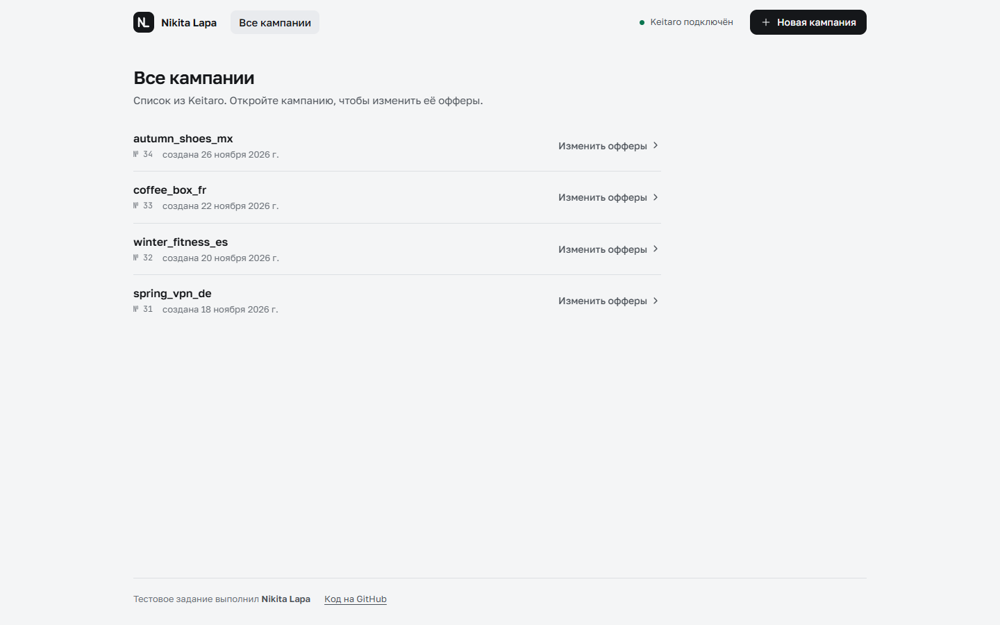
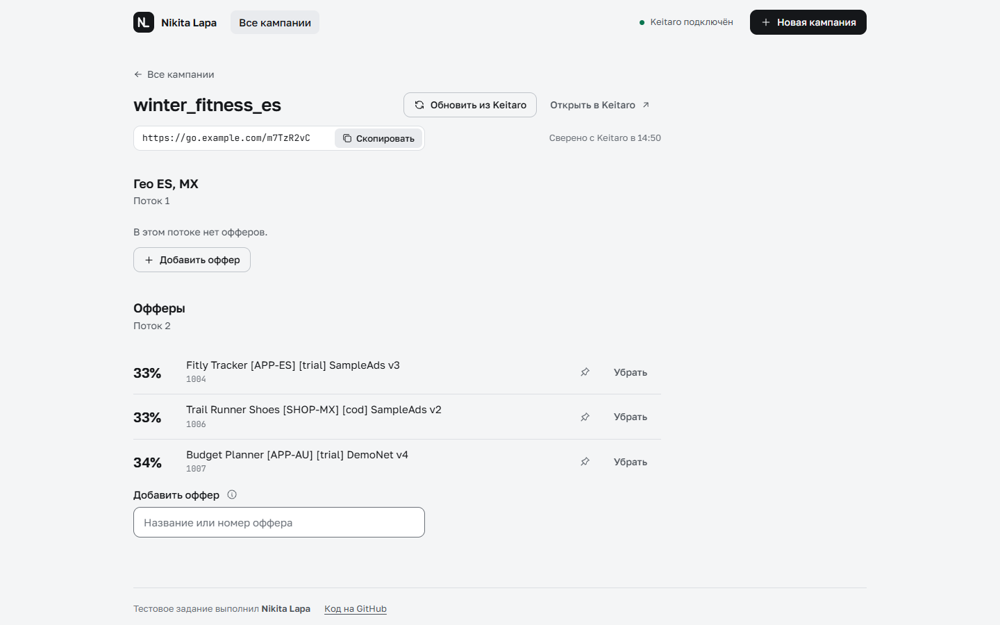
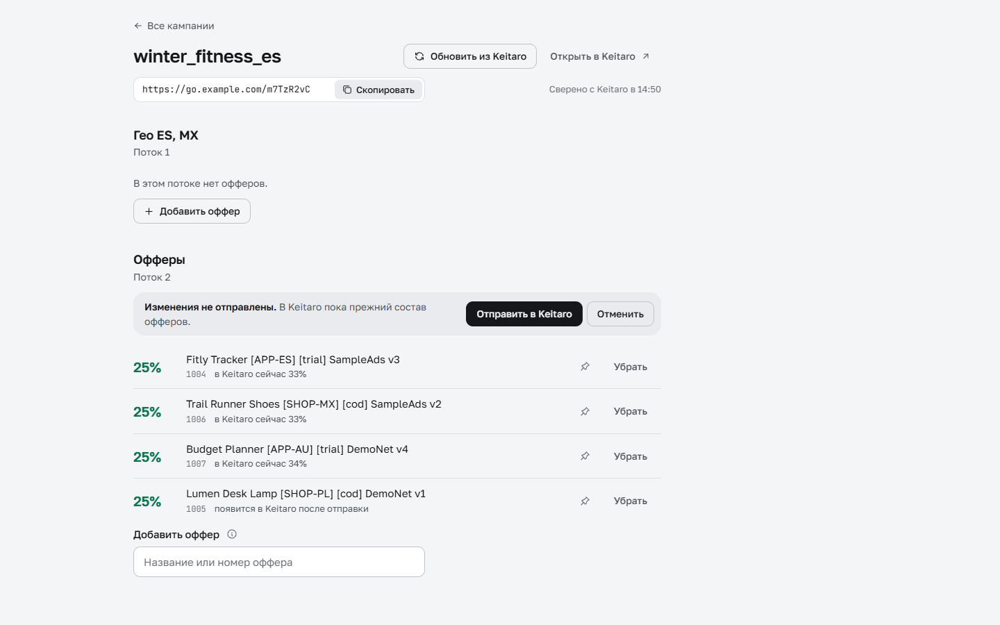

<h1 align="center">Keitaro Campaign Builder</h1>

<p align="center">A small web app for the Keitaro tracker: create a ready-to-run two-flow campaign with one click, and edit offers in existing campaigns with shares that rebalance themselves.</p>

<p align="center">
  
  
  
  
  <a href="https://github.com/nikito4kv/keitaro_wrapper/actions"></a>
  
</p>

<p align="center"></p>

## What it does

- **Creates a campaign in one click.** Name, countries and an offer go in; a campaign with two flows comes out in Keitaro.
- **Flow 1 is a geo-filter flow:** visitors from the chosen countries are redirected to a neutral URL (`https://google.com` by default, configurable).
- **Flow 2 is the default flow:** everyone else goes to the selected offer.
- **Remembers the boring parts.** Domain, campaign group and traffic source are picked once from Keitaro's own lists and reused for every new campaign.
- **Edits offers in any existing campaign.** Add or remove offers in any flow of any campaign in the tracker, not only the ones created here.
- **Rebalances shares automatically.** Free offers split the remaining percent evenly, and any share can be pinned so it stays put.
- **Draft first, send second.** Changes are saved as a draft and shown next to what Keitaro has now; nothing reaches the tracker until you press "Send to Keitaro".

## Why it's interesting

- **A draft layer on top of someone else's API.** Edits live in the app's own database and are diffed against the last state read from Keitaro, so the UI can show "in Keitaro now: 33%" next to every pending change. A draft survives closing the tab.
- **Replace-the-whole-list push.** One `PUT /streams/{id}` per flow replaces the whole offer list in a single request. The app also switches a flow to the offers schema when an offer is added to a flow that did not serve any, and warns before sending anything that would leave a flow empty.
- **No half-made campaigns.** If Keitaro accepts the campaign but rejects one of its flows, the app removes the campaign and tells the user why, instead of leaving a one-flow campaign behind.
- **The share rule lives in one pure function** (`app/shares.py`), pinned down by tests (33/33/34, then 25 x 4, then 38/37 with one pinned at 25, and so on).
- **Errors in one shape.** Keitaro failures (bad key, missing Admin API, validation errors per field) are translated into plain messages, and field errors land under the right form field.
- **Small and dependency-light.** The UI is plain HTML, CSS and JavaScript with no build step, fonts are self-hosted, and the page makes no requests to third-party sites.

## Tech stack

| Layer | Tools |
|---|---|
| Backend | Python 3.10+, FastAPI, Pydantic v2 / pydantic-settings, httpx |
| Data | SQLAlchemy 2, Alembic, SQLite (PostgreSQL supported via `DATABASE_URL`) |
| Frontend | Vanilla HTML / CSS / JavaScript, no bundler, self-hosted fonts |
| Tests | pytest, FastAPI TestClient, in-process fake Keitaro |

## Screenshots

The interface is in Russian. All data below comes from the bundled fake Keitaro, so every name, domain and offer is made up.

**Filling the form: countries, offer, and a live preview of both flows**



**All campaigns from the tracker**



**Offer editor: three offers at 33 / 33 / 34**



**Adding a fourth offer rebalances to 25 x 4. Nothing is sent until you confirm.**



## Quick start

Needs Python 3.10 or newer (tested on 3.12). Commands are for macOS/Linux; on Windows activate the venv with `.venv\Scripts\Activate.ps1`.

```bash
git clone https://github.com/nikito4kv/keitaro_wrapper.git
cd keitaro_wrapper
python3 -m venv .venv
source .venv/bin/activate
pip install -r requirements.txt
cp .env.example .env          # then set KEITARO_URL and KEITARO_API_KEY
alembic upgrade head          # creates keitaro_manager.db
uvicorn app.main:app          # http://127.0.0.1:8000
```

On first launch, press "Choose" in the "Domain, group and source" block, pick the values and save. After that you can create campaigns.

**Run the whole demo without a real Keitaro.** `scripts/fake_keitaro.py` is a tiny in-memory stand-in for the Admin API, pre-filled with made-up campaigns, offers and `example.com` domains:

```bash
# terminal 1
python scripts/fake_keitaro.py            # http://127.0.0.1:8099
# terminal 2 (same venv); set the two variables in .env, or export them like this
export KEITARO_URL=http://127.0.0.1:8099 KEITARO_API_KEY=demo-key
alembic upgrade head && uvicorn app.main:app
```

Settings (`.env` or environment variables): `KEITARO_URL`, `KEITARO_API_KEY`, `DATABASE_URL` (default: SQLite file), `GEO_REDIRECT_URL` (default `https://google.com`), `KEITARO_TIMEOUT` (default 15 seconds). A detailed step-by-step guide for beginners (in Russian) is in [docs/README.ru.md](docs/README.ru.md): migrations, PostgreSQL, the exact requests sent to Keitaro, design decisions and known limitations.

## Project structure

```
app/
  main.py         app entry, page routes, uniform error responses
  api.py          JSON endpoints under /api
  services.py     campaign creation, defaults, offer search
  editor.py       offer editor: sync with Keitaro, drafts, push
  shares.py       the share-splitting rule (one pure function)
  keitaro.py      Admin API client with a short-lived cache for reference lists
  models.py       3 tables: defaults, created campaigns, stream offers (drafts)
  schemas.py      request/response models and form validation
  static/         the whole UI: 3 HTML pages, app.css, js/, fonts/
migrations/       Alembic migrations
scripts/          fake_keitaro.py: runnable demo stand-in for Keitaro
tests/            56 test cases + the fake Keitaro they run against
docs/             README.ru.md (detailed guide), screenshots/
```

## Tests & quality

```bash
pip install -r requirements-dev.txt
pytest
```

56 test cases run in a few seconds and never touch the network or a `.env` file. They use an in-memory SQLite database and an in-process fake Keitaro (`tests/fake_keitaro.py`) that records every request, so tests can assert the exact payloads sent to the tracker. Coverage by area:

- **Campaign creation:** both flows with exact payloads, rollback when a flow is rejected, duplicate names, unknown or deleted offers, form validation.
- **Offer editor:** a step-by-step walkthrough (add, send, add and cancel, remove, restore, changes made directly in Keitaro, pin), empty flows, drafts surviving a reopen, deleted offers still shown by name.
- **Share rule, reference data and offer search:** rounding and pinning, search by words and by number, wrong or missing API key.
- **Migrations:** upgrade to head, `alembic check` (models and migrations agree), downgrade to base.

CI runs `pytest` on every push and pull request (Python 3.10 and 3.12).

## Status & roadmap

A working, tested tool; the interface is Russian only. The app has no login and is meant to run on a local machine or an internal network, so do not expose it to the internet as is.

- Optional password protection for shared deployments.
- English interface strings next to the Russian ones.
- Let a push detect that someone changed the flow in the tracker meanwhile, instead of overwriting it (today "Refresh from Keitaro" is the safeguard).


## License

MIT. See [LICENSE](LICENSE).

---
Built by [Nikita Lapa](https://github.com/nikito4kv) · built with an AI-assisted workflow
